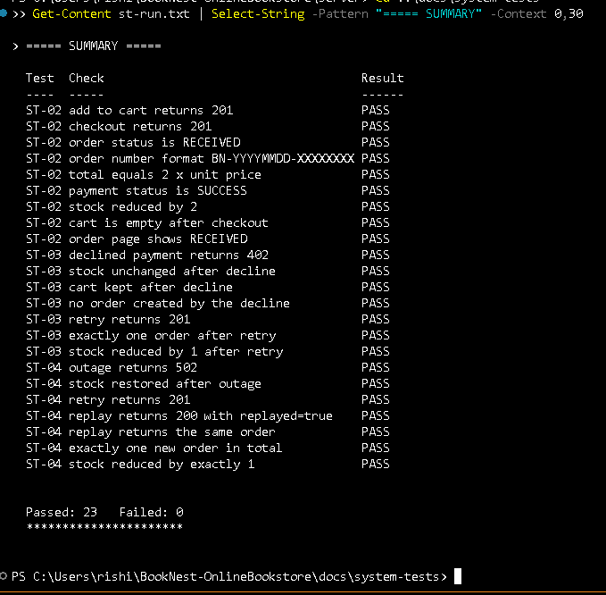

# System Validation Report

**Project:** BookNest Online Bookstore  
**Branch / commit:** `main` @ `b6086ab`  
**Run date:** 5 November 2026 (scripted system runs); 7 November 2026 (Jest)  
**Tool:** Jest (`--runInBand --coverage`), MongoDB in Docker for integration tests

## 1. Scope and method

System validation was done in two ways:
1. **Automated integration tests** (86 tests in 7 suites, run against a real MongoDB through the Express app). Results are in section 3.
2. **Scripted API runs** (`docs/system-tests/system-tests.ps1`) for the three end-to-end flows ST-02, ST-03 and ST-04, run against the live API on `localhost:5000` with the seeded customer. Results are in section 2.

**Limitations (stated honestly):**
- The scripted runs are API-level. The client has no checkout page, so the UI steps of ST-02 (search, detail page, five screens) were not exercised.
- ST-04 uses the mock gateway token `tok_error` to simulate a gateway outage. It is not a real network timeout.
- Only the test cases listed below have an actual result. Every other Test Plan case is listed in section 5 as not executed.

## 2. System test runs (live API)

Run result: **23 checks, 23 passed, 0 failed.** Transcript: `docs/system-tests/st-run.txt`. Screenshot of the run summary:

| Test | Check | Result |
|---|---|---|
| ST-02 | add to cart returns 201 | PASS |
| ST-02 | checkout returns 201 | PASS |
| ST-02 | order status is RECEIVED | PASS |
| ST-02 | order number format BN-YYYYMMDD-XXXXXXXX | PASS |
| ST-02 | total equals 2 x unit price | PASS |
| ST-02 | payment status is SUCCESS | PASS |
| ST-02 | stock reduced by 2 | PASS |
| ST-02 | cart is empty after checkout | PASS |
| ST-02 | order page shows RECEIVED | PASS |
| ST-03 | declined payment returns 402 | PASS |
| ST-03 | stock unchanged after decline | PASS |
| ST-03 | cart kept after decline | PASS |
| ST-03 | no order created by the decline | PASS |
| ST-03 | retry returns 201 | PASS |
| ST-03 | exactly one order after retry | PASS |
| ST-03 | stock reduced by 1 after retry | PASS |
| ST-04 | outage returns 502 | PASS |
| ST-04 | stock restored after outage | PASS |
| ST-04 | retry returns 201 | PASS |
| ST-04 | replay returns 200 with replayed=true | PASS |
| ST-04 | replay returns the same order | PASS |
| ST-04 | exactly one new order in total | PASS |
| ST-04 | stock reduced by exactly 1 | PASS |

## 3. Automated integration tests

Result: **86 tests, 86 passed, 0 failed.**

| Suite | Tests | Passed | Failed | Time |
|---|---|---|---|---|
| `tests/integration/orderStp.test.js` | 13 | 13 | 0 | 14.8 s |
| `tests/integration/admin.test.js` | 13 | 13 | 0 | 8.0 s |
| `tests/integration/cart.test.js` | 13 | 13 | 0 | 6.6 s |
| `tests/integration/orders.test.js` | 12 | 12 | 0 | 5.3 s |
| `tests/integration/auth.test.js` | 14 | 14 | 0 | 4.1 s |
| `tests/integration/books.test.js` | 15 | 15 | 0 | 2.7 s |
| `tests/integration/gaps.test.js` | 6 | 6 | 0 | - |

| File | ID | Test | Duration | Result |
|---|---|---|---|---|
| `orderStp.test.js` | TC-TRK-01 | Order tracking (UC-05, FR-009) owner sees the status, items and total of an order | 723 ms | PASS |
| `orderStp.test.js` | TC-TRK-02 | Order tracking (UC-05, FR-009) another customer gets 404 for the order | 557 ms | PASS |
| `orderStp.test.js` | TC-TRK-03 | Order tracking (UC-05, FR-009) malformed id is 400 and unknown id is 404 | 247 ms | PASS |
| `orderStp.test.js` | TC-TRK-04 | Order tracking (UC-05, FR-009) tracking without a token is 401 | 236 ms | PASS |
| `orderStp.test.js` | TC-TRK-06 | Order tracking (UC-05, FR-009) an order keeps its original prices after the book price changes | 248 ms | PASS |
| `orderStp.test.js` | TC-TRK-07 | Order history (UC-08, FR-010) history is own orders only, newest first, paged | 723 ms | PASS |
| `orderStp.test.js` | TC-TRK-08 | Order history (UC-08, FR-010) page 3 has the last 2 orders and page 4 is empty | 524 ms | PASS |
| `orderStp.test.js` | TC-TRK-09 | Order history (UC-08, FR-010) a new customer has an empty history | 339 ms | PASS |
| `orderStp.test.js` | TC-TRK-10 | Order history (UC-08, FR-010) invalid page or limit is rejected with 400 | 446 ms | PASS |
| `orderStp.test.js` | TC-ORD-08 | Checkout rules from the STP two buyers of the last copy: one order, one refusal, stock never negative | 762 ms | PASS |
| `orderStp.test.js` | TC-ORD-09 | Checkout rules from the STP client-supplied price and total are ignored | 349 ms | PASS |
| `orderStp.test.js` | TC-ORD-11 | Checkout rules from the STP a book disabled after being carted blocks checkout with 409 | 326 ms | PASS |
| `orderStp.test.js` | TC-SEC-04 | Payment data (SEC-005) only status and gateway reference are stored, no card data or token | 294 ms | PASS |
| `admin.test.js` | ST-SEC-05..08 | Admin US-08 / SEC-002: role-based access refuses a customer token with 403, not 404 or 200 | 473 ms | PASS |
| `admin.test.js` | ST-SEC-05..08 | Admin US-08 / SEC-002: role-based access refuses a customer creating a book | 448 ms | PASS |
| `admin.test.js` | ST-SEC-05..08 | Admin US-08 / SEC-002: role-based access refuses a customer disabling a book | 358 ms | PASS |
| `admin.test.js` | ST-SEC-05..08 | Admin US-08 / SEC-002: role-based access refuses an unauthenticated request with 401 | 321 ms | PASS |
| `admin.test.js` | ST-SEC-05..08 | Admin US-08 / SEC-002: role-based access allows an admin token | 353 ms | PASS |
| `admin.test.js` | IT-ADM-01..06 | Admin US-07: catalog management creates a listing | 336 ms | PASS |
| `admin.test.js` | IT-ADM-01..06 | Admin US-07: catalog management rejects a creation missing the title | 313 ms | PASS |
| `admin.test.js` | IT-ADM-01..06 | Admin US-07: catalog management rejects a negative price | 308 ms | PASS |
| `admin.test.js` | IT-ADM-01..06 | Admin US-07: catalog management updates stock quantity | 314 ms | PASS |
| `admin.test.js` | IT-ADM-01..06 | Admin US-07: catalog management rejects a fractional stock quantity | 331 ms | PASS |
| `admin.test.js` | IT-ADM-01..06 | Admin US-07: catalog management disabling removes the book from customer search immediately | 314 ms | PASS |
| `admin.test.js` | IT-ADM-01..06 | Admin US-07: catalog management still shows disabled books to the admin | 295 ms | PASS |
| `admin.test.js` | IT-ADM-01..06 | Admin US-07: catalog management 404s when updating an unknown book | 279 ms | PASS |
| `cart.test.js` | ST-SEC-04 | Cart requires authentication | 343 ms | PASS |
| `cart.test.js` | - | Cart starts empty with a zero total | 286 ms | PASS |
| `cart.test.js` | IT-CART-01 | Cart adds an available book | 315 ms | PASS |
| `cart.test.js` | - | Cart snapshots the price at the time of adding | 271 ms | PASS |
| `cart.test.js` | - | Cart merges a repeat add into the existing line | 266 ms | PASS |
| `cart.test.js` | IT-CART-02 | Cart refuses to exceed available stock | 217 ms | PASS |
| `cart.test.js` | IT-CART-03 | Cart refuses an out-of-stock book | 191 ms | PASS |
| `cart.test.js` | - | Cart refuses a disabled book | 186 ms | PASS |
| `cart.test.js` | UT-CART-10 | Cart rejects a quantity of zero | 180 ms | PASS |
| `cart.test.js` | - | Cart updates a quantity and recalculates the total | 204 ms | PASS |
| `cart.test.js` | - | Cart refuses an update above available stock | 238 ms | PASS |
| `cart.test.js` | - | Cart removes an item | 216 ms | PASS |
| `cart.test.js` | - | Cart keeps one customer cart separate from another | 525 ms | PASS |
| `orders.test.js` | IT-ORD-01 | Checkout (US-09, US-10, US-17) success creates an order, decrements stock and empties the cart | 432 ms | PASS |
| `orders.test.js` | IT-ORD-02 | Checkout (US-09, US-10, US-17) empty cart is rejected with 400 | 200 ms | PASS |
| `orders.test.js` | IT-ORD-03 | Checkout (US-09, US-10, US-17) declined payment returns 402, restores stock, keeps the cart, creates no order | 215 ms | PASS |
| `orders.test.js` | IT-ORD-04 | Checkout (US-09, US-10, US-17) same Idempotency-Key twice creates one order and charges once | 219 ms | PASS |
| `orders.test.js` | IT-ORD-05 | Checkout (US-09, US-10, US-17) stock that dropped below the cart quantity returns 409 and changes nothing | 180 ms | PASS |
| `orders.test.js` | IT-ORD-06 | Checkout (US-09, US-10, US-17) checkout without a token returns 401 | 11 ms | PASS |
| `orders.test.js` | IT-ORD-07 | Checkout (US-09, US-10, US-17) two orders get different order numbers | 317 ms | PASS |
| `orders.test.js` | IT-ORD-08 | Checkout (US-09, US-10, US-17) a customer cannot read another customer's order | 303 ms | PASS |
| `orders.test.js` | IT-ORD-09 | Checkout (US-09, US-10, US-17) a raw card number is rejected (SEC-005) | 145 ms | PASS |
| `orders.test.js` | IT-ORD-10 | Checkout (US-09, US-10, US-17) gateway outage returns 502 and restores stock | 145 ms | PASS |
| `orders.test.js` | IT-ORD-11 | Checkout (US-09, US-10, US-17) missing paymentToken returns 400 | 137 ms | PASS |
| `orders.test.js` | IT-ORD-12 | Checkout (US-09, US-10, US-17) customer lists only their own orders | 291 ms | PASS |
| `auth.test.js` | UT-AUTH-01..04 | Auth POST /api/v1/auth/register creates an account and returns a token | 202 ms | PASS |
| `auth.test.js` | UT-AUTH-01..04 | Auth POST /api/v1/auth/register SEC-001: stores a bcrypt hash, never the plaintext password | 138 ms | PASS |
| `auth.test.js` | UT-AUTH-01..04 | Auth POST /api/v1/auth/register SEC-001: never returns the hash in the response body | 132 ms | PASS |
| `auth.test.js` | UT-AUTH-01..04 | Auth POST /api/v1/auth/register rejects a duplicate email with 409 | 129 ms | PASS |
| `auth.test.js` | UT-AUTH-01..04 | Auth POST /api/v1/auth/register rejects a malformed email with 400 | 10 ms | PASS |
| `auth.test.js` | UT-AUTH-01..04 | Auth POST /api/v1/auth/register rejects a password under 8 characters | 10 ms | PASS |
| `auth.test.js` | UT-AUTH-01..04 | Auth POST /api/v1/auth/register ignores a client attempt to self-assign the admin role | 145 ms | PASS |
| `auth.test.js` | UT-AUTH-05..07 | Auth POST /api/v1/auth/login returns a signed JWT for correct credentials | 282 ms | PASS |
| `auth.test.js` | UT-AUTH-05..07 | Auth POST /api/v1/auth/login rejects a wrong password with 401 | 292 ms | PASS |
| `auth.test.js` | UT-AUTH-05..07 | Auth POST /api/v1/auth/login gives the same error for an unknown email, so accounts cannot be enumerated | 12 ms | PASS |
| `auth.test.js` | ST-SEC-01..03 | Auth SEC-004: token validation rejects a request with no token | 12 ms | PASS |
| `auth.test.js` | ST-SEC-01..03 | Auth SEC-004: token validation rejects a tampered token | 205 ms | PASS |
| `auth.test.js` | ST-SEC-01..03 | Auth SEC-004: token validation rejects an expired token | 141 ms | PASS |
| `auth.test.js` | ST-SEC-01..03 | Auth SEC-004: token validation accepts a valid token | 143 ms | PASS |
| `books.test.js` | IT-CAT-01..05 | Catalog GET /api/v1/books lists active books | 177 ms | PASS |
| `books.test.js` | IT-CAT-01..05 | Catalog GET /api/v1/books US-07: never shows a disabled listing to customers | 22 ms | PASS |
| `books.test.js` | IT-CAT-01..05 | Catalog GET /api/v1/books searches by title | 24 ms | PASS |
| `books.test.js` | IT-CAT-01..05 | Catalog GET /api/v1/books searches by author, case-insensitively | 23 ms | PASS |
| `books.test.js` | IT-CAT-01..05 | Catalog GET /api/v1/books returns an empty set rather than an error when nothing matches | 19 ms | PASS |
| `books.test.js` | IT-CAT-01..05 | Catalog GET /api/v1/books treats regex characters in a query as literal text | 21 ms | PASS |
| `books.test.js` | IT-CAT-06..10 | Catalog US-04: filters filters by minimum price | 26 ms | PASS |
| `books.test.js` | IT-CAT-06..10 | Catalog US-04: filters filters by maximum price | 24 ms | PASS |
| `books.test.js` | IT-CAT-06..10 | Catalog US-04: filters filters by a price range | 26 ms | PASS |
| `books.test.js` | IT-CAT-06..10 | Catalog US-04: filters excludes out-of-stock books when inStock is on | 23 ms | PASS |
| `books.test.js` | IT-CAT-06..10 | Catalog US-04: filters combines a search with a filter rather than replacing it | 27 ms | PASS |
| `books.test.js` | IT-CAT-06..10 | Catalog US-04: filters rejects a non-numeric price filter with 400 | 21 ms | PASS |
| `books.test.js` | - | Catalog GET /api/v1/books/:id returns one book | 17 ms | PASS |
| `books.test.js` | - | Catalog GET /api/v1/books/:id 404s on an unknown id | 15 ms | PASS |
| `books.test.js` | - | Catalog GET /api/v1/books/:id 404s on a malformed id instead of throwing a 500 | 18 ms | PASS |
| `gaps.test.js` | TC-CAT-03 | Gap-closing tests filters by genre, case-insensitively | 284 ms | PASS |
| `gaps.test.js` | TC-CAT-08 | Gap-closing tests operator objects in query are not executed and do not leak data | 145 ms | PASS |
| `gaps.test.js` | TC-SEC-05 | Gap-closing tests operator injection in login is refused | 170 ms | PASS |
| `gaps.test.js` | TC-ADM-03 | Gap-closing tests admin edits a price and customers see the new price | 164 ms | PASS |
| `gaps.test.js` | TC-ADM-05 | Gap-closing tests stock cannot be set below zero | 128 ms | PASS |
| `gaps.test.js` | TC-ADM-07 | Gap-closing tests a disabled book can be re-enabled | 140 ms | PASS |

## 4. Security tests covered by the integration suites

| Group | Covered by | Result |
|---|---|---|
| ST-SEC-01..03 token validation (no token, tampered, expired, valid) | `auth.test.js` | PASS |
| ST-SEC-04 cart requires authentication | `cart.test.js` | PASS |
| ST-SEC-05..08 role-based access (customer gets 403, anonymous 401, admin allowed) | `admin.test.js` | PASS |
| TC-SEC-04 / SEC-005 no card data stored | `orderStp.test.js`, IT-ORD-09 | PASS |
| TC-SEC-05 login operator injection | `gaps.test.js` | PASS |

## 5. Not executed

The Test Plan exit criterion asks for 100% of cases executed. That was not achieved. The following were **not executed**, and no result is claimed for them:

| Case | Reason |
|---|---|
| TC-PERF-01 (performance / load) | Not run within the two-sprint schedule |
| TC-AVL-01 (availability) | Not run; the system was only run locally |
| TC-USE-01 (usability) | Not run; the client has no checkout screens |
| TC-SAF-01 | Not run |
| OWASP ZAP scan | Not run |
| UI steps of ST-02 and any UI-driven test | No checkout screens in the client |
| Other Test Plan cases not listed in the integration table | Not mapped or run in this report |

These are recorded as deviations in `DEVIATIONS.md`.

## 6. Conclusion
All executed tests passed: 103/103 automated tests and 23/23 scripted system checks. The system validation is complete for the executed scope and incomplete against the full Test Plan, for the reasons in section 5.
